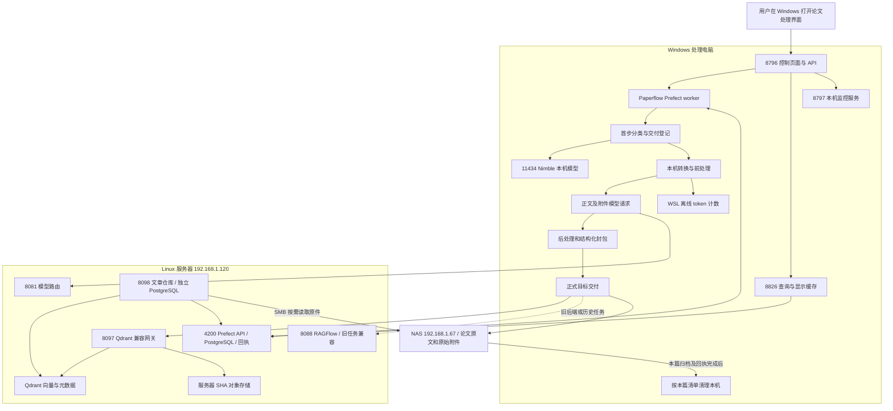

# 宿主机、服务器和 NAS 在 Paperflow 项目中的作用

核验日期：2026 年 11 月 15 日，时区 Asia/Shanghai。本文面向远程接手检查项目的工程师。

本文把“当前配置”“当前运行快照”“源码实现”和“尚未验证”分开。运行快照见 [runtime-snapshot.json](../evidence/runtime-snapshot.json)，部署目录及容器证据见 [server-runtime.snapshot.json](../evidence/server-runtime.snapshot.json)，具体代码位置见 [代码证据索引](03-代码证据索引.md)。这是源码交接与只读核验，没有启动论文任务、调用付费模型、修改路由、重启服务、归档或删除任何业务文件。

## 1. 先理解三者怎样配合

**Windows 宿主机是处理工作台和主要执行端；Linux 服务器提供编排、模型路由、检索和文章目录等共享服务；NAS 保存论文原件及原始附件。**

这里“宿主机”指用户目前使用的 Windows 处理电脑，不表示已经确认它是某个虚拟化平台的物理宿主。服务器与 NAS 在同一局域网中，但承担不同职责，不能互相代替。

| 部分 | 最主要的工作 | 重要状态或数据 | 本次实际核对 |
| --- | --- | --- | --- |
| Windows 处理电脑 | 页面与操作入口、文件接收、分类、前处理、模型请求组织、后处理、入库交付、NAS 复制、本机收尾 | 任务工作区、本机模型请求 journal、响应文件、模板、共享源码、查询缓存 | 8796/8797/8826/11434 正在本机 loopback 监听；当前控制与查询模块、计划任务已核对 |
| Linux 服务器 `192.168.1.120` | Prefect 编排与持久状态、8081 模型路由、8097 Qdrant 网关、8098 文章库、旧 RAGFlow 等 | 原生 FlowRun、Artifact 回执、PostgreSQL 目录数据、向量数据、SHA 对象文件、模型账户与路由配置 | 通过 SSH 只读检查相关容器、镜像标识、端口、Compose 路径及持久卷；Prefect 与 Qdrant 健康接口返回 200 |
| NAS `zwjy-nas` / `192.168.1.67` | 长期保存论文原件与附件，供后续下载和追溯 | 原始正文、原始附件及其归档目录 | 本机 DNS A 记录为 `.67`；当前配置的归档根目录只读访问成功；未写入文件、未做全盘内容校验 |

一个重要区别：**远程编排不等于远程执行。** Prefect API 和数据库在 Linux 服务器，当前 Paperflow 的主要处理 worker 在 Windows 电脑上。因此服务器开着，并不能替代 Windows 完成 Word/WPS 转换、本机文件读取或本机模型调用。

## 2. 当前拓扑

图中的箭头表示调用或数据依赖；NAS 到 Cleanup 的箭头表示完成条件，不表示 NAS 会主动删除 Windows 文件。清理由 Windows 上的程序执行。图中没有把共享服务误画成同一份数据库，也没有把源码副本当成生产运行环境。

## 3. 宿主机具体做什么

### 3.1 提供用户操作与结果查看入口

当前本机有以下服务：

| 端口 | 当前作用 | 绑定范围与证据 |
| --- | --- | --- |
| `8796` | 新工单控制页面与 API；创建、开始、暂停、确认操作等 | `127.0.0.1`；运行模块为 `paperflow_v3.control.launch` |
| `8826` | 独立查询服务、汇总投影、显示缓存 | `127.0.0.1`；运行模块为 `paperflow_v3.control.dashboard_api`，缓存目录为当前 V3 的 `runtime/dashboard-query/current` |
| `8797` | 本机监控服务 | `127.0.0.1`；入口位于 V3 `runtime/panel-monitor/panel_service.py`，源码副本收录在仓库的 `runtime-code` 目录 |
| `11434` | Nimble 本机模型服务，首步分类等依赖它 | `127.0.0.1`；实际进程为 `F:\nimble\runtime\ollama.exe serve` |
| `8795` | 旧候选目录仍提供被复用的资源/监控源码 | 本次没有该端口监听；目录存在并不代表它仍是主服务入口 |

8796、8826、8797 分工不同。页面能打开只证明入口可访问；查询结果可能来自缓存，不证明每篇论文的最新业务状态已经完成。

这几项都绑定 loopback。工程师从外地克隆 GitHub 后，不能直接通过其电脑上的 `127.0.0.1` 访问用户的处理电脑。局域网地址也不能直接从互联网访问。现场连接或远程访问需另行建立，GitHub 本身不会建立内网通道。

### 3.2 执行论文处理

主要项目根目录为 `F:\论文预处理系统\预处理系统2`。当前主入口位于 `candidates/parent-child-v3-20261102`，共享实现位于 `prefect-paperflow`，底层还依赖 `F:\论文预处理系统\程序`、选中的旧 release 和原始 core。

典型处理顺序是：

1. 读取用户提交或接收的本机文件，识别论文组、正文和附件。
2. 使用首步实现做分类、必要的格式转换、交付和登记。
3. 在 Prefect 中登记原生父工单和论文子工单。
4. 本机做解析、正文清理、材料准备、长度/token 计数与请求封包。
5. 通过服务器 8081 路由发送正文、附件及必要的全文排名请求。
6. 保存原请求身份、响应和摘要，进行后处理及交付验证。
7. 将结果交给正式检索目标，核对入库结果。
8. 把原文和原始附件归档到 NAS。
9. 服务器回执及本篇前提满足后，按冻结清单清理本机文件，完成子工单。

以上不同阶段可以有不同论文同时处理。配置中的并发额度只表示名额，不等于已经验证了相同数量的持续吞吐。

### 3.3 本机还保存恢复所需的材料

本机请求 journal、响应文件、工作清单和共享模块路径参与恢复判断。它们不都是“随时可删的缓存”。模型回答已经成功保存时，下游失败应优先复用相同身份的回答；不能因为后处理或 NAS 失败就重新请求模型。

Windows 重启或 worker 重建可能使旧控制 session 失效，需要重新核对任务身份与准入。服务器仍有回执，并不表示所有本机材料都可以丢弃。

### 3.4 当前运行绑定

本次只读核对到以下计划任务处于 Running：

- `Paperflow-V3-Control-8796`：启动 V3 `serve-paperflow.ps1`。
- `Paperflow-V3-Query-8826`：启动 V3 `serve-query.ps1`。
- `Paperflow-Panel-Monitor-8796`：启动本机 panel service；计划任务名称中的 8796 不等于其监听端口。

Windows 进程中存在 `control.worker` 与 `control.stage_worker`。Prefect 当前部署 `parent` 和 `paper` 的 entrypoint 分别是 `flows.py:parent_order`、`flows.py:paper_order`，`working_dir` 均指向当前 V3 目录，池为 `paperflow-v3-parent-child`。在线列表本次返回一个 StageProcessWorker；历史 OFFLINE 记录不应直接当成当前故障，也不能仅靠进程行数判断存在重复执行器。

## 4. Linux 服务器具体做什么

### 4.1 Prefect：编排、状态与服务器回执

`http://192.168.1.120:4200/api` 是当前配置中的 Prefect API。服务器提供工作池、deployment、FlowRun、共享资源限制、Variable、Artifact 回执等能力。Windows worker 从这里获得或协调工作，并把阶段证据写回来。

本次容器镜像为 Prefect `3.9.0-python3.12`，本机 Python 包为 Prefect `3.9.0`。`/api/version` 另外返回 `0.8.4`，这是该 API 的版本标识；不能据此把 Prefect 产品版本写成 0.8.4。

主要容器包括 Prefect server、PostgreSQL 和 demo-runner。demo-runner 的存在不证明它正在替代 Windows 的正式论文 worker。编排数据库和回执持久卷没有纳入 GitHub。

### 4.2 8081：模型 API 路由

Windows 当前模型配置使用 `http://192.168.1.120:8081/v1`。这里负责接收兼容模型请求，再按现有路由及账户配置转发。实际生成通常由路由后面的模型服务完成，不能因为请求经过 Linux 就认为模型权重都在这台服务器上。

8081 的路由管理凭据、账户、令牌及余额等留在原环境。仓库只交接相关客户端代码、模型配置样例、部署元数据与服务关系。本次没有调用模型，没有修改、刷新或重新导入账户与路由。

服务端还运行与 WorkBuddy 相关的 hub。它属于模型链的共享依赖，工程师应先核对实际请求路径和接入契约，不能为修复某篇论文直接修改共享账户或全局路由。

### 4.3 8097：当前主入库后端的 Qdrant 网关

本次当前磁盘配置是 `rag_backend=qdrant`，`rag_url` 与 `qdrant_gateway_url` 指向 `http://192.168.1.120:8097`。健康接口返回 `backend=qdrant`。新任务的具体写入仍应以其冻结配置和逐篇回执核对。

8097 是项目的兼容网关，不是 Qdrant 原生 6333 端口。网关提供 folder 交付、datasets/documents、检索及 SHA 对象读写接口；后面连接 Qdrant。

它保存的不仅是向量：适配器也会上传图像、原附件、部分 retained 材料和原始模型回答。当前服务器上分别持久化：

| 存储 | 服务器位置 | 用途 |
| --- | --- | --- |
| Qdrant 向量及元数据 | `/opt/paperflow-qdrant-20261103/qdrant-data` | 文档切片、向量和检索元数据等 |
| 网关对象文件 | `/opt/paperflow-qdrant-20261103/objects` | 按摘要寻址的图像、附件等对象 |

这两个数据目录没有上传。源码在 `server-live/qdrant`；Windows 侧交付适配器在当前 V3 的 `paperflow_qdrant`。部署目录源码与运行镜像中的全部文件尚未逐文件对照，不能只凭目录存在宣称镜像已加载每项磁盘修改。

### 4.4 8098：独立文章仓库

文章仓库是 PostgreSQL 文章目录、检索整合、人工修订和 NAS 文件下载服务，使用独立 `article_pgdata` 卷，并连接 Qdrant。它不是 RAGFlow 的另一个名字。

它从已满足接入证明的 Paperflow 结果更新目录。**目录已有一篇文章，不表示该篇 NAS 与本机清理都已完成。** 导入判定、NAS 文件可用性观察、用户下载时的 SHA/大小核对，是不同步骤。

服务器通过 Python `smbclient` 直接访问 NAS，不必先把共享挂载成 Linux CIFS/NFS 目录。因此本次 `findmnt` 没列出 CIFS/NFS，不能推出 NAS 没有被使用。

仓库中的 `paperflow/article-repository` 是 Windows 工作副本；`server-live/article-repository` 是服务器部署目录中可读取源码的副本。两者都有交接价值，尚未证明彼此完全一致，工程师不应未经比较就相互覆盖。

### 4.5 8088：RAGFlow 仍存在，但不是当前配置中的唯一主链

RAGFlow 8088 容器本次仍在运行，旧目标及历史回执的兼容分支仍在代码中。历史文件中关于 RAGFlow、旧通道数和旧清理策略的描述，应按其日期理解。

不能把当前 Qdrant 的状态套到旧 RAGFlow 工单；也不能删除旧失败或 unknown 回执来强行统一后端。具体任务用什么后端，应查看该任务绑定来源与目标回执。

### 4.6 1Panel：服务器运维入口

1Panel 用于管理服务器上的应用、容器及相关配置。它是运维控制面，不是论文处理中的分类、模型、NAS 或向量服务本身。其登录凭据和安全入口路径没有上传。本次只确认管理端口可达，没有登录或变更面板。

## 5. NAS 具体做什么

### 5.1 保存原始材料

当前归档根配置使用 `\\zwjy-nas\paper_ai\论文原件库\Prefect五步\统一五步正式`。文章仓库另使用 `\\192.168.1.67\paper_ai\论文原件库` 作为原件根。

NAS 保存一份论文原文和原始附件，归档身份按任务与论文组组织；不是因为一篇论文被投到多个专业库，就给每个专业复制一份 NAS 原件。

NAS 原件与 Qdrant 派生结果用途不同：前者支持原文下载与追溯，后者支持检索及结构化使用。GitHub 源码快照也不能代替 NAS 原件备份。

### 5.2 成功归档与本机清理之间的条件

当前实现的成功收尾要求正式目标核验、NAS 清单完成及服务器证据满足条件，然后才逐文件清理本机。

**清理对象包含登记清单内的本机来源原文、交付副本和本篇独占中间材料。** 当前系统并不保证成功后本机仍保留所有原件；NAS 是重要的原件保存位置。未归档的其他文件、其他论文、共享数据库和程序不应被当作本篇清理目标。

当前 V3 的 NAS 归档实现按文件保存 intent、复制到临时名、flush/fsync、rename、保存 complete。未知结果会阻断自动继续；它没有提供“每个 NAS 文件完成后再全量读回并计算 SHA”的统一证明。文章仓库下载时的摘要核验也不能替代整批归档回读。

本次仅确认根目录可访问，没有创建 NAS 测试文件，没有检查全盘容量、RAID、快照、备份或逐篇原件完整性。这些项目仍需现场另行核验。

### 5.3 归档成功清理与“删除工单”不同

“删除工单”是另一条独立路径，会处理该工单的独占工作区、服务器记录、原生运行和显示缓存；它与逐篇成功后的归档清理有不同保护边界。暂停、隐藏页面、重试、删除工单也不能互相替代。

工程师检查时首先保存原身份和证据，避免通过清空工作区、删除回执或新建一个任务掩盖问题。

## 6. 状态怎样跨三处保存

| 信息 | 主要位置 | 为什么要保留 |
| --- | --- | --- |
| task/group/paper/attempt/FlowRun 等身份 | Prefect 与本机记录 | 判断是否同一任务、同一请求或原任务恢复 |
| 模型 intent、请求和响应摘要、原始回答 | 本机 journal/文件及绑定服务器回执 | 证明是否已发送、是否可复用，防止重复请求 |
| 正式目标交付结果 | Prefect 回执、Qdrant/旧 RAG 后端 | 判断是否真的入库及目标是否完整 |
| NAS 保存结果 | NAS 文件和服务器归档回执 | 判断是否可进入后续清理 |
| cleanup 冻结清单及结果 | 服务器回执与本机残留文件 | 区分未删、已删、明确失败与结果未知 |
| 页面汇总 | 8826 等派生缓存 | 改善显示；不是全部原始事实的唯一来源 |
| 文章目录及人工修订 | 8098 的 PostgreSQL | 独立持久目录；其存在不等于整篇工单完成 |

恢复时至少区分以下四种情况：

| 状态 | 含义 | 处理边界 |
| --- | --- | --- |
| 确认未发送 | 有证据证明请求还未真正进入网络调用 | 按原身份与现有机制决定下一步 |
| 明确失败 | 完整错误和身份能证明终态失败 | 按既有规则及用户选择处理 |
| 已完成 | 响应/交付与摘要、身份、目标能对应 | 优先复用，避免重复发送 |
| `unknown` | 可能已发生外部副作用但本地/回执不完整 | 保留证据，不自动重发、切号或换路由 |

429、503、超时、断电和丢回执都不能只靠 HTTP 数字判断可重试。当前 V3 与旧恢复适配层存在语义差异，工程师需要沿真实调用方核对，不能先假定全部路径已经统一。

## 7. 某一部分不可用时会怎样

| 故障位置 | 常见影响 | 首先应检查的证据 |
| --- | --- | --- |
| Windows 关机或 worker 退出 | 本机处理停止；服务器可能保留旧运行和回执 | 计划任务、原 PID/创建时间、worker 心跳、原 FlowRun、控制 session、本机 journal |
| Prefect/API/其数据库异常 | 准入、资源租约、状态写回或查询受影响 | 服务健康、数据库连接、同身份的操作回执和原始 Artifact；页面可用不等于状态保存成功 |
| 8081 或上游模型异常 | 新模型请求受阻，部分请求结果未知 | 单次请求日志与完整终态证据；不按状态码自动重放 |
| 8097/Qdrant 异常 | 正式入库或检索验证不能完成 | 原目标进度、effect/request 身份、对象精确回读、folder complete 和检索证明 |
| 8098 文章仓库异常 | 目录页面、同步、下载可能受影响 | 独立 PostgreSQL、导入 ledger、Qdrant 与 SMB 状态；不要据此重新跑整条论文链 |
| NAS/SMB 异常 | 归档或下载受阻；本篇清理不应绕过前提 | 原文件清单、NAS 共享权限/路径、归档回执、missing 与 unknown 的区别 |
| LAN/DNS 异常 | 多个远程服务看起来同时失效 | `.120`、NAS 主机名、SMB 与对应端口连通性；不能据此判定所有业务都未发生 |
| 8826 缓存滞后 | 页面数字暂时落后 | 缓存时间、原始回执与计数单位；不能直接把数字差当成失败量 |

## 8. 本次源码交接怎样对应原机器

| GitHub 目录 | 来源与定位 |
| --- | --- |
| `paperflow/` | `F:\论文预处理系统\预处理系统2` 的可公开工程文件；保留主链与历史候选的相对结构 |
| `desktop-program/` | `F:\论文预处理系统\程序` 的源码、模板、部分 vendor 源码与当前选中 release |
| `legacy-original-core/` | 当前路径配置引用的原始 core 的可公开源码 |
| `legacy-upstream/` | 当前路径配置引用的旧桌面/上游工程的可公开源码 |
| `workbench/` | E 盘已定位工作台 release 的可公开源码；不是宣称 8089 为当前论文主入口 |
| `server-live/` | 服务器上相关部署目录可读源码与部署元数据的只读副本 |
| `nimble-launchers/` | 本机 Nimble 启停脚本和说明；不含运行时二进制及模型权重 |
| `evidence/` | 脱敏运行快照、包版本、来源清单及本次导出摘要 |
| `docs/` | 本说明、工程师接手指南、代码证据及上传范围说明 |

配置使用 `.example.json` 或 `.env.example`，不是可直接用于生产的凭据配置。服务器源码副本、历史源码和当前主链均有明确目录，不用目录名称中“新”“最终”等文字替代真实调用证据。

## 9. 接手时最值得先核查的工程问题

1. **确认完整调用链和版本。** 当前旧 source manifest 有 581 项，未覆盖当前 V3 与首步全部代码。仓库导出 manifest 能证明上传了什么，不能自动替代生产发布身份。
2. **核对多份同名模块。** clean_overlay、当前 release、base desktop、FIRST 等按顺序进入导入路径，需要确认实际 `__file__` 与加载时间，不能只看磁盘最新时间。
3. **核对路径与依赖。** Windows 绝对路径、继承系统包的 `.venv`、WSL token 计数器、WPS/Office、Nimble 权重、外部前端依赖均不是只靠一份 requirements 就能复现。
4. **统一恢复判断前先审计调用方。** 保留请求/attempt 身份、原始回执和 unknown，证明重复请求问题是否真实发生，再讨论修复。
5. **核对交付与目录计数口径。** 模型成功数、论文完成数、RAG 文档数、文章目录数、NAS 文件数不是一一对应。
6. **核对公开产物隐私。** 当前附件适配器明确有 `privacy_redaction=not_performed`，服务器对象也可能包含原附件或回答；不要把业务产物目录直接推到公开仓库。
7. **先隔离验证，再安排生产操作。** 源码检查和临时 fixture 测试，与重启 worker、改变共享路由、恢复真实任务或清理来源文件是不同范围。

建议阅读顺序：[工程师远程检查指南](02-工程师远程检查指南.md) → [代码证据索引](03-代码证据索引.md) → 当前 V3 三份 HANDOFF → 相关实现和测试。上传范围、遗漏与复现限制见 [上传范围与验证](04-上传范围与验证.md)。
