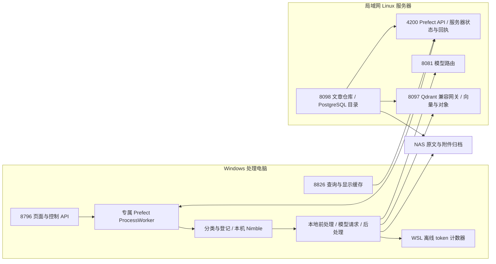

# 代码与配置证据索引

核验日期：2026-11-15。本附件的研究范围是本机只读源码和配置；没有访问外网、SSH 或业务 HTTP，没有启停服务、运行任务、运行测试、读取真实论文内容或修改生产文件。在线运行快照另见 evidence/runtime-snapshot.json 和 server-runtime.snapshot.json，须单列时间、命令与证据，不能把下列静态证据改写成运行验收。

## 证据口径与路径缩写

- **代码支持**：当前磁盘源码直接实现或调用该行为，不能单独证明运行进程已经加载它。
- **配置支持**：当前磁盘配置声明该参数或目标，不能单独证明服务可达、凭据可用、资源生效或业务完成。
- **本机路径核验**：只确认所指定的本机路径存在，不加载业务模块，也不检查密钥内容。
- **尚未实时核验**：本研究未检查该事实的在线状态，交接时应由带时间戳的运行证据补足。

所有代码引用的 `:行号` 均为本次磁盘文件的一基行号；后续修改会使行号漂移。路径缩写如下：

| 缩写 | 完整本机路径 |
| --- | --- |
| `ROOT` | `F:\论文预处理系统\预处理系统2` |
| `V3` | `ROOT\candidates\parent-child-v3-20261102` |
| `PF` | `ROOT\prefect-paperflow` |
| `FIRST` | `ROOT\candidates\first-step-control-20261029` |
| `SITE` | `ROOT\candidates\prefect-folder-frontend-20261101` |
| `PREVIEW` | `ROOT\candidates\first-step-preview-8795` |
| `AR` | `ROOT\article-repository` |
| `PROGRAM` | `F:\论文预处理系统\程序` |
| `RELEASE` | `PROGRAM\updates\unified-prefect-20261029-material-r02` |

## 最重要的交接结论

1. **工程不是单目录即可复制运行的项目。** V3 入口同时依赖 PF 的虚拟环境和配置、FIRST 的首步模块、SITE 的静态页面、PREVIEW 的监控脚本、PROGRAM/RELEASE 的旧业务模块，以及 E 盘的 WSL 离线计数器资源。依据：`V3\serve-paperflow.ps1:4-10`、`V3\paperflow_v3\control\launch.py:14-31`、`PF\paperflow_prefect\legacy.py:14-37`、`PF\runtime-config.json:29-44`。
2. **当前磁盘配置选择 Qdrant 网关。** `PF\config.json:45-46` 为 `rag_backend=qdrant` 与 8097 网关；`rag_url` 也指向 8097（`:16`）。用户另行提供的 RAGFlow 8088 是环境中的另一服务，不能仅据其存在把它画成当前新论文的唯一主后端。运行中的后端仍需按实际加载配置和逐篇回执核对。依据：`V3\paperflow_v3\delivery\runtime.py:258-310`。
3. **旧 RAGFlow 与新 Qdrant 的回执有兼容分支。** 已完整完成的旧目标可继续复用，存在旧事件时新 Qdrant 进度使用 `rag-qdrant-*`，防止覆盖历史。不能通过删除旧失败/unknown 记录来“统一”后端。依据：`V3\paperflow_v3\delivery\backend.py:4-29`、`runtime.py:260-280`。
4. **新工单用 Prefect 原生父子 FlowRun 和服务器回执；本地也有恢复材料。** 原生父子关系、请求身份、事件回执、派生快照、本机模型 journal 和交付进度不是同一份状态。迁移只复制源码会失去恢复上下文。依据：`control\parent.py:41-58`、`control\flows.py:370-410`、`control\receipts.py:42-86`、`stages\llm_request.py:117-186`。
5. **当前逐篇成功链会清理本机来源原文。** 清理对象包含清单内来源文件、交付副本和本篇独占工作材料；前提是正式目标、NAS 与相应回执完成。不能向工程师笼统承诺“本地原件永久保留”。依据：`delivery\cleanup.py:21-66`、`delivery\runtime.py:326-351`。
6. **Qdrant 网关也保存对象。** 适配器上传图像、原附件、部分原始模型回答和 retained 内容，不能把它描述为只保存文本向量。附件后处理明确标记 `privacy_redaction=not_performed`。依据：`V3\paperflow_qdrant\delivery.py:54-58,71-92,96-112,143-164`、`V3\paperflow_v3\stages\attachment_adapter.py:260-264`。
7. **来源清单不覆盖整条运行链。** 当前 `PF\config.json:14` 指向的 source manifest 静态统计为 581 项；文件路径前缀覆盖 PROGRAM/desktop 与 RELEASE/core、desktop，没有 V3 或 FIRST。`legacy.bind` 验证这些列入清单的文件，不等于验证了所有运行代码。依据：`PF\paperflow_prefect\legacy.py:21-37`；该结论来自本次 manifest 结构统计，未重算全部 581 项文件哈希。

## Windows、Linux 服务器与 NAS 的分工

图是代码与配置关系，不是本次在线拓扑探测结果。NAS 主机名和 IP 的等价性、Linux 当前部署路径、容器镜像和卷，均需在线快照证据支持。

| 部分 | 代码/配置支持的职责 | 主要证据 | 本研究未实时核验 |
| --- | --- | --- | --- |
| Windows 处理电脑 | 提供本机页面与控制 API，启动专属 worker，读取本机来源文件，分类登记、前后处理、模型调用、RAG 交付、NAS 复制与本地清理 | `V3\paperflow_v3\control\launch.py:79-105`；`control\flows.py:62-115,272-329` | PID、已加载模块、开机启动、worker 当前在线状态与任务状态 |
| Prefect 服务器 | 远程编排 API、原生任务关系、共享资源、Variable 准入状态、Artifact 回执与快照 | `PF\config.json:4`；`V3\paperflow_v3\control\admission.py:31-54,70-116`；`receipts.py:55-83` | 数据库部署、备份、服务版本、历史回执完整性 |
| 模型路由服务器 | Windows 向 OpenAI 兼容 `/v1` 入口发送正文/附件等模型请求，当前源代码对路由目标也有固定校验 | `PF\model-config.json:2,7`；`V3\paperflow_v3\control\server.py:29-44` | 可用账户、模型、额度、实际通道容量与正在进行的调用 |
| Qdrant 网关 | 接收 folder 批次、SHA 对象，提供兼容 datasets/documents/retrieval API；当前选中的新后端 | `PF\config.json:45-46`；`V3\paperflow_qdrant\delivery.py:134-187` | 网关完整服务端源码位置、当前镜像、向量集合和对象存储状态 |
| NAS | Windows 按 task/group 路径保存清单内原文与附件；文章仓库从服务器直接通过 SMB 读取这些原件 | `PF\config.json:15`；`V3\paperflow_v3\delivery\runtime.py:333-341`；`AR\compose.yaml:29`；`AR\article_repository\files.py:12-39` | NAS 可读/写性、容量、备份、共享权限、主机名解析与挂载情况 |
| 文章仓库 | 独立持久目录、人工修订与下载；读已完成的 RAG/后处理证据，不调度 Paperflow 流程 | `AR\article_repository\server.py:21-80`；`imports.py:26-38,97-139`；`README.md:3-5` | 当前运行数据、覆盖数量、同步状态和下载成功率 |

### 端口与地址：必须区分默认值和现网值

| 端口/入口 | 静态证据 | 交接解释 |
| --- | --- | --- |
| `127.0.0.1:8796` | `V3\paperflow_v3\control\launch.py:81-86,103-105` | V3 本机控制与页面默认端口，可由 `PAPERFLOW_V3_PORT` 覆盖；源码只绑定 loopback，不能假定远程工程师可直接访问 |
| `127.0.0.1:8826` | `V3\serve-query.ps1:16-19`；`control\dashboard_api.py:95-107` | 独立查询/缓存服务；控制页与查询服务需要一起识别版本 |
| `192.168.1.120:4200/api` | `PF\config.json:4`；`AR\compose.yaml:28` | 当前配置的 Prefect API；V3 会核对其环境变量与配置是否一致（`control\flows.py:32-46`） |
| `192.168.1.120:8081/v1` | `PF\model-config.json:2,7`；`V3\paperflow_v3\control\server.py:38-40` | 当前模型路由目标，存在代码级主机/端口/路径限制；仅替换配置不一定能迁移到另一主机 |
| `127.0.0.1:11434/v1/systemone` | `PF\config.json:33`；`control\flows.py:530-534` | 当前首步本机 Nimble 地址；不是服务器 embedding 地址 |
| `192.168.1.120:8097` | `PF\config.json:16,45-46` | 当前 Qdrant 兼容网关，不等于 Qdrant 原生 6333 |
| Docker 网络内 `paperflow-qdrant:6333` | `AR\compose.yaml:27,36-39` | 文章仓库依赖已有 Qdrant 外部 Docker 网络；本 Compose 不负责创建它 |
| `192.168.1.120:8098` | `AR\compose.yaml:32-33`；`AR\Dockerfile:9` | 文章仓库对外端口；内部 PostgreSQL 未声明宿主机端口映射 |
| `172.17.0.1:11436` | `AR\article_repository\server.py:28` | `EMBEDDING_URL` 未设置时的默认 embedding 地址，真实环境变量可覆盖；不能当作当前实测值 |
| RAGFlow `8088` | 用户环境说明及历史交接文档 | 当前静态 config 已选择 8097/Qdrant。8088 的当前用途、旧任务关联由在线核验补足，不从历史文档推断新链正在写入 |

## 从页面到逐篇完成的实际调用链

| 顺序 | 当前源码接线 | 关键身份和完成条件 | 证据 |
| --- | --- | --- | --- |
| 1 | `serve-paperflow.ps1` 使用 PF `.venv` 启动 `paperflow_v3.control.launch` | 环境读取显式 project config、FIRST、SITE；必要文件缺失即拒绝启动 | `V3\serve-paperflow.ps1:4-10`；`control\launch.py:14-34` |
| 2 | launcher 验证专属 process 池，创建 parent/paper 两个 deployment，启动 `control.worker` | 默认池 `paperflow-v3-parent-child`；deployment 的 working_dir 指向 V3 根；已存在在线 worker 时先等待其原生离线 | `control\launch.py:37-76,79-100`；`control\deploy.py:12-21` |
| 3 | worker 加载运行配置，刷新控制 session，再启动 `stage_worker` | 重启使旧 Start 准入失效；worker 受 launcher PID 监视，不应留下孤立轮询 worker | `control\worker.py:14-16,36-60`；`control\admission.py:50-54,79-116` |
| 4 | `server.create_configured_app` 提供 API 与 SITE 静态资源，复用 PREVIEW 监控/资源采样 | 当前路由能力读 auto_config 凭据并验证 8081 `/v1`；不是一个独立无依赖的 FastAPI 包 | `control\server.py:16-57,69-80` |
| 5 | 创建/开始/暂停 API 控制父工单；`parent_order` 调 `classify_and_dispatch` | 首步从 FIRST 的 `paperflow_prefect` 以别名包加载；禁止同进程混用其他 FIRST 来源 | `control\api.py:347,489,743`；`control\flows.py:518-535`；`control\classification.py:47-67` |
| 6 | 首步分类、交付、登记合格后，`schedule_registered_paper` 用 `arun_deployment(...as_subflow=True)` 派发原生子工单 | 必须 passed、delivery_complete、registered；幂等键为 task+group；不先建一套外部调度器 | `control\parent.py:41-58` |
| 7 | `paper_order` 验证原生父子关系、deployment、幂等键与登记，建立完整 identity | task_id、group_id、paper_id、receipt_id、attempt_id、parent_run_id、task_run_id 贯穿；这里 attempt_id 使用子 FlowRun ID | `control\flows.py:370-410` |
| 8 | `_process_step` → `stages.pipeline.process_paper`：前处理 → 单段/分段正文、附件请求 → 全文排名 → 后处理 | backend、模板、catalog、计数器和独占目录由现有实现复用；处理阶段本身不执行 NAS/清理 | `control\flows.py:62-86`；`stages\pipeline.py:10-23,74-80` |
| 9 | `_delivery_step` 在线程中调用 `delivery.runtime.deliver_paper` | 重新读取同子工单服务器回执；完整后处理交接与工作清单后才进入正式 RAG 目标 | `control\flows.py:89-115`；`delivery\runtime.py:184-205,237-245` |
| 10 | 新配置走 `paperflow_qdrant.delivery.deliver_folder`；旧分支复用正式 RagPublisher/附件发布器 | Qdrant 上传后核对 folder complete、完整元数据/库归属/条数和检索结果；旧分支同样有发布、启用、回读与检索核验 | `delivery\runtime.py:283-325`；`paperflow_qdrant\delivery.py:143-186`；`delivery\publication.py:40-57` |
| 11 | RAG 全目标完成 → NAS 按文件复制 → 清理清单逐文件删除 → 子工单返回 complete | 流程结束/响应已保存不等于整篇完成；最终路径要求同 identity 的 cleanup complete 服务器凭据 | `delivery\runtime.py:326-352`；`control\flows.py:327-329` |

上述 `control/...`、`stages/...`、`delivery/...` 缩写默认位于 `V3\paperflow_v3`；`paperflow_qdrant/...` 位于 `V3` 根。

### 共享并发与本篇工作区

`control\flows.py:50-58` 使用 Prefect 全局资源名 `paperflow-connected-*`：local 前处理、total/body/attachment LLM、package 后处理、rag、nas、cleanup。当前磁盘 `PF\config.json:19-27` 配置为正文 50、附件 50、模型总 50、local 5、package 10、rag 20、nas 2、cleanup 2。这是**配置值**，本研究没有读回实际 Prefect 限额或活动占用，更没有验证持续吞吐。

当前源码要求 cleanup 使用独立资源，不能与 NAS 资源名重叠（`delivery\runtime.py:191-192`）。历史交接文档中“清理重用 NAS 名额”的描述已不能替代当前代码。分类线程并发、外部账户容量、模型限流与 Prefect 资源限额也不能直接相加为端到端吞吐。

## 代码与配置的跨目录依赖

| 需要交给工程师定位的对象 | 当前事实与证据 | 可迁移性说明 |
| --- | --- | --- |
| `PF\config.json` | `program_root`、`release_root`、`settings_root`、template/catalog/model/runtime/source manifest、NAS、history 等是配置键；路径值见 `:5-16,31-48` | 应制作脱敏样例与字段说明；不能只给 V3 源码 |
| `PROGRAM\desktop`、`RELEASE\desktop`、`RELEASE\core` | `legacy.bind` 把 clean_overlay、两个 desktop 路径和 core 插入 `sys.path`；安装 preextract_tree_relations 兼容层，见 `PF\paperflow_prefect\legacy.py:26-37` | 多份同名模块按路径优先级解析；工程师应记录实际 `__file__`，不能凭目录名判断唯一实现 |
| `PF\paperflow_prefect\clean_overlay` | 在 `legacy.bind` 中优先于 native 路径，见 `legacy.py:29-32` | 属于当前真实处理依赖，不可遗漏 |
| `PROGRAM\config\paths.json` | `python`、`production_app`、`runtime_dir`、`original_core`，见 `:3-7` | `original_core\.venv\Lib\site-packages` 可能被追加到 sys.path，见 `legacy.py:33-35`；这是 requirements 之外的环境依赖 |
| `FIRST` | V3 从 FIRST 加载 `first_step_control`、nimble、分类/排序、接收、登记、回执、资源模块，见 `control\classification.py:47-67` | 需要其源码和测试；不应把 FIRST 内另一份 config 当成 V3 实际配置，V3 会设置 `PAPERFLOW_CONFIG`（`flows.py:44-46`） |
| `SITE` | 页面根与 `query-config.json` 由环境/默认路径指定，见 `control\server.py:51-57,80` | 与 8796 API、8826 查询服务的接口约定要一同交接 |
| `PREVIEW\host_resources_api.py`、`workbuddy_monitor.py` | launcher 检查 host resource 文件；server 动态导入监控和资源采样，见 `launch.py:24-26`、`server.py:24-27,69-78` | 8795 目录名只是依赖来源，不等于其服务一定仍是主入口 |
| `PROGRAM\resources\论文预提取_空白模板_v1.1_研究类型.md` | 当前 `template_path` 所选模板，`PF\config.json:10`；前处理冻结 path/SHA，见 `stages\preprocessing.py:80,102` | 模板版本不能仅按文件名排序选最高版；旧任务有原绑定模板与旧版本兼容 |
| 旧 `论文预提取_空白模板_v1.md` | `PF\paperflow_prefect\body_template.py:6,24-45` 对旧交接退回原版，存在已有 model 目录时也有兼容分支（`:48-56`） | 原绑定模板变更会拒绝继续（`:15-20`）；只携带新模板不足以恢复全部历史任务 |
| E 盘计数器模型与 Linux 运行时 | `PF\runtime-config.json:29-44` 使用 E 盘模型、libllama.so、cache、linux-runtime-manifest，命令指定 `wsl.exe --distribution Ubuntu-22.04 --exec ... python3 -B` | 是 Windows 本机 WSL 离线计数器，不是远程服务器 embedding 服务；需列路径、运行时与模型摘要，不能只复制 JSON |
| PF `.venv` 和系统 Python | `PF\.venv\pyvenv.cfg:1-5` 为 CPython 3.14.0，`include-system-site-packages=true`；`PF\requirements.txt:1-2` 只固定 Prefect 3.9.0、filelock 3.29.0 | 虚拟环境继承系统包，当前 requirements 不是完整可复制环境；还需依赖清单与外部工具版本证据 |
| `V3\requirements-query.txt` | `async-lru==2.4.0`，见 `:1-2` | 属于额外查询运行依赖，基础 PF requirements 中没有它 |
| `AR\Dockerfile` 与网关基础镜像 | 直接 `FROM paperflow-qdrant-20261103-gateway`，并覆盖 `/app/paperflow_qdrant/library.py`，见 `:1-9` | Dockerfile 依赖未随 AR 独立生成的基础镜像；只给 AR requirements 不能重建全部网关依赖 |
| `AR\frontend\vite.config.js` | Ant Design alias 指向工程之外旧看板 node_modules，见 `:5`；package.json 只有 vite build 脚本 | 工程师应拿构建依赖说明/lock 和已构建 dist，不能把本机 node_modules Junction 当通用安装方式 |

本次对 `program_root`、`release_root`、`settings_root`、`template_path`、`catalog_path`、`source_manifest`、`gateway_admission_source` 做了只读 `Test-Path -LiteralPath`，均存在。`PROGRAM\config\paths.json` 指定的 original_core、production_app、runtime_dir 也存在。该结果**不证明凭据可读、源文件摘要一致、模块已加载或可在另一台机器复制运行**。没有读取 settings_root 的密钥内容。

## unknown、回执、响应复用与恢复边界

| 状态 | 当前代码的判定与动作 | 证据 |
| --- | --- | --- |
| 确认未发送 | `http_invoked=False` 可以形成 not_sent；容量拒绝另有 `llm_gateway_not_dispatched` 绑定证明，内存投影不会改写原 journal | `stages\llm_request.py:56-84` |
| 明确失败 | 必须保存匹配哈希的完整 HTTP 错误、没有响应正文/事件、合法明确拒绝状态等；413 不作为原样重试 | `stages\llm_request.py:85-111` |
| 响应完成 | 请求/响应 SHA、路径、原始字节和服务器身份全部相符后复用已有回答；复用发生在请求准入之前，不再次占模型发送路径 | `stages\llm_request.py:235-274` |
| 结果未知 | 429、5xx 在当前 V3 分支保留 unknown；intent/started/unknown 未收口、本机有 journal 却无服务器绑定、身份冲突都阻断新发送 | `stages\llm_request.py:89-93,114,117-186` |

不能根据“HTTP 429/503”“本机文件找不到”“另一请求已成功”就批准重发。当前旧适配层 `PF\paperflow_prefect\profile_recovery.py:152-195` 在完整 `explicit_transient_response` 证据下存在可重试判断，而 V3 对部分相同 HTTP 数字保留 unknown。两者来自不同路径，交接应保留这项兼容差异，并核查具体调用方，不先断言它们已经统一或已经发生重复调用。

重要机制：

- **操作去重**：Start/Pause 等操作用 request_id 与 intent_seq 记录；同 request_id 只复用原结果。intent 已保存、operation 结果缺失时投影为 unknown，不重复执行。`control\operations.py:21-66`。
- **服务器回执**：`save_receipt` 先创建原始 Artifact，再尽力更新派生快照。快照更新失败会记录 gap，不等于原始回执不存在。原始 Artifact、indexed 标记、快照之间需按来源 ID核对。`control\receipts.py:42-86`。
- **开始/暂停与重启**：任务 running 状态必须匹配当前控制 session；重启会刷新 session。暂停阻止新操作的最终准入，已经获准的单次网络/文件操作可能继续收尾并保存结果，不等于撤销已发送请求。`control\admission.py:31-54,79-124`；`stages\llm_request.py:42-53,225-233`。
- **原生恢复身份**：子 FlowRun 要核对原 parent_task_run_id、deployment 和幂等键。恢复 scope 检查原状态 ID和派发证据，不能把另一次新建任务当续跑。原运行进程核对还比较 `PREFECT__FLOW_RUN_ID`，不凭 PID 存在就认定原执行器。`control\flows.py:374-392`；`control\recovery.py:85-127`。
- **恢复准备有副作用**：`prepare_scope` 会暂停并对经核对的原 FlowRun 提议 Crashed 状态，再读回；它不是只读诊断函数。`control\recovery.py:137-164`。交接资料可说明其逻辑，不应把调用它列入默认只读检查。
- **旧 RAG 请求去重**：`ServerEffects` 用 scope+action 计算 effect_id；returned 复用结果、残留 intent 阻断、明确 failed 需用户选择重试；intent 与返回结果都要求服务器保存成功。`delivery\transport.py:18-70`。
- **Qdrant 对象丢回执**：对象 PUT 遇到传输错误后，通过精确 SHA GET 回读确认；该路径不重放上传。读取最多三次并逐次检查暂停。folder POST 仍须服务端返回 complete，并通过元数据/检索核验。`V3\paperflow_qdrant\delivery.py:16-33,143-184`。网关服务端的幂等/批次恢复还需取得完整服务端源码与当前运行版本。

## NAS、逐篇清理与删除工单：三个不同边界

### NAS 归档

`delivery\archive.py:8-33` 要求归档清单覆盖正文和附件、identity/目标路径不变、路径为相对路径；in_flight/unknown 阻断，明确失败只在 `retry_failed=True` 时允许处理。逐文件先存服务器 intent，再复制到 `.paperflow-part`，flush/fsync 后 rename，再存 complete。复制失败写 failed；rename 或最终保存失败可能留下未知，不自动再复制。成功项跳过（`:35-94`）。

该 V3 归档函数没有增加 NAS 整文件 SHA 回读或下载核验；不能把“已记录归档完成”写成“已对 NAS 每个文件重新读回并算哈希”。这与文章仓库的按需下载校验是不同机制，后者见下节。

### 逐篇成功后的本机清理

`delivery\cleanup.py:21-55` 检查 1—3 个正式目标、正文身份/来源摘要/专业、verified/retrieval_verified、附件正式目标核验、同 identity 的 NAS 全文件 complete，缺一阻断。`:57-66` 将排除资料和 NAS 目标列为保护项，但将 `source_path` 与交付 `path` 纳入删除清单。`:85-117` 每文件先保存 intent，再 unlink，再存结果；未知阻断继续，成功项不重做。

`delivery\owned_work.py:7-34` 只收集独占工作根中的文件，拒绝与 source/NAS 重叠及 symlink/Junction 越界。`delivery\runtime.py:342-345` 还要求服务器 stage_work_inventory 的本篇文件在本机清单中完整存在。独占工作区包含本组第一步和本篇处理材料；共享数据库、程序、其他论文及未列入归档的垃圾不应纳入逐篇成功清理。

出现 cleanup 记录时，恢复路径可以直接读取原服务器冻结清单继续，不重新运行已依赖被删原件的处理阶段，见 `control\flows.py:290-308` 与 `delivery\runtime.py:128-181,215-230`。工程师排障不能先“清空工作目录”或删除 journal 再尝试恢复。

### 用户明确删除工单

`control\deletion.py` 是独立的破坏性路径。它构造本任务数据根和交付进度的清理计划，保护 source_paths 与 NAS（`:76-115`）；停止原生工单并确认退出（`:142-191`），再清本任务独占本机材料、回执/artifacts、FlowRun、相关变量和显示缓存，见 `:251-344`。它会删除本工单的诊断/恢复证据，不可与暂停、隐藏页面或逐篇成功清理混用。

此研究没有调用任何归档、清理、删除或恢复准备函数。

## 文章仓库的独立边界

`AR\compose.yaml:2-39` 声明单独的 PostgreSQL 18.6 容器、article_pgdata 卷、repository 服务、外部 Qdrant Docker 网络和服务器 NAS 根。`Dockerfile:1-9` 的基础镜像来自现有 Qdrant 网关；AR 自己的 Python 增量依赖是 psycopg 3.3.3 与 smbprotocol 1.17.0（`requirements.txt:1-2`）。实际服务器部署目录 `/opt/paperflow-article-repository` 是 `README.md:9` 的交接记载，本研究没有 SSH 核验。

`article_repository\server.py:21-31` 把目录数据库、Qdrant/Haystack Library、embedding、SMB 文件服务与 Importer 接在一起。启动时可能初始化目录、导入历史 JSON，再每 60 秒刷新新链资料；独立文件观察循环更新 NAS availability，见 `:33-75`。因此启动一个未隔离的“本地试运行”可能触及业务数据库/导入，不能当作无副作用的只读检查。

**文章已进入目录不等于整条 Paperflow 归档清理完成。** Importer 的接入证明绑定后处理 validation passed、同子 FlowRun 的 `rag_complete`、来源/manifest 摘要、正式库归属和创建顺序；该判定没有要求 `nas` 或 `cleanup` complete（`imports.py:26-38,97-139`）。文件初始可用性是 unknown，之后另行观察。目录计数不能替代全链完成数量。

SMB 读文件使用 `smbclient`，不要求 Linux 一定存在 CIFS/NFS 挂载。`article_repository\files.py:12-39` 使用 SMB session/stat/open_file；无挂载证据不能推出“NAS 没有被用”。路径禁止绝对路径、`..` 和驱动器冒号（`:44-51`）；观察时 available 主要确认大小，missing 与 unknown 分开（`:54-66`）；下载才按登记 SHA/大小核验（`:68-79`）。

人工修订优先与 Qdrant 同步见 `article_repository\sync.py`；更新先写可读的新修订目标，再使旧版本失效，`:75-86,121-145`。目录导入 ledger 跨重启保留，读取失败不自动重放旧导入，见 `imports.py:76-86`。评分、分类、年份等维护/自动化脚本虽同处 AR，不能因为“交接文章仓库”就授权重启它们；本研究没有执行这些入口。

## 建议交给远程工程师的文件边界

以下是交接源文件清单建议，不是已制作/审查完成的可公开压缩包。任何原始业务数据、journal、服务器导出、历史输入 JSON或日志都需要另行审查；源码测试中也要检查硬编码路径、地址、真实样本和个人字段。

| 类别 | 具体建议 |
| --- | --- |
| 当前主链源码 | `V3\paperflow_v3\control`、`stages`、`delivery`；`V3\paperflow_qdrant`；`PF\paperflow_prefect`（包括 clean_overlay 与 llm_queue）；FIRST 首步源码；SITE 静态源码；PREVIEW 中实际动态导入的两个监控/采样脚本 |
| 外部依赖源码 | RELEASE/core、RELEASE/desktop、PROGRAM/desktop 中通过 manifest/实际导入使用的代码；PROGRAM/config/paths.json 的脱敏样例；原 original_core 的依赖定义；Qdrant 网关完整服务端源码与 Docker 构建上下文，不仅是 V3 的三文件客户端适配包 |
| 入口与部署定义 | `V3\serve-paperflow.ps1`、`serve-query.ps1`、`open-paperflow.ps1`、requirements-query.txt；`PF\requirements.txt`；`AR\Dockerfile`、compose.yaml、requirements.txt、frontend/package.json、package-lock 与 vite.config.js；服务器在线快照中的脱敏 compose/镜像版本另附 |
| 模板与规则 | 当前正文模板与恢复旧任务必要的旧版模板；`PF\docs\templates\附件交付模板_v1.md`；正式 catalog/majors/classification 等规则应按用途审查再纳入，不能把包含业务论文的 JSON 一概当配置 |
| 交接文档 | `V3\CONTROL_HANDOFF.md`、STAGES_HANDOFF.md、DELIVERY_HANDOFF.md；`ROOT\docs\大小工单改造-交付与逐项验收报告-20261102.md`、`大小工单改造-任务验收标准与验收记录-20261102.md`、`第一步分类登记与本地接收交接-20261031.md`；PF/docs 接口说明；AR/README.md 与 requirements.md |
| PF 配置样例 | `config.example.json` 对照现有 config 的完整字段；`model-config.example.json`；`runtime-config.example.json`；source-manifest 示例和生成规则。样例使用占位地址、占位根目录和示意摘要，凭据只说明外部加载渠道，不复制真实 settings 目录 |
| AR 环境样例 | 列出 ARTICLE_DATABASE_URL、ARTICLE_DATABASE_SCHEMA、ARTICLE_IMPORT_ENABLED、ARTICLE_POSTGRES_PASSWORD、QDRANT_URL、QDRANT_API_KEY、QDRANT_COLLECTION、PREFECT_API_URL、ARTICLE_NAS_ROOT、ARTICLE_NAS_USER、ARTICLE_NAS_PASSWORD、EMBEDDING_URL 等变量名及用途；值全部用占位符，数据库 URL 必须整体脱敏 |
| 必要恢复材料 | 若要协助真实任务故障，另经授权提供最小的身份映射、状态摘要、摘要哈希与脱敏错误；原请求/回复、完整回执、论文和附件留在用户控制的私有区，不混进源码交接包 |

### 现有测试：推荐保留，不宣称本次已通过

- V3 控制链：`tests/control/test_full_candidate_chain.py`、`test_parent_dispatch.py`、`test_deployed_subflow.py`、`test_paper_entry.py`、`test_operation_confirmation.py`、`test_operation_prefect_isolation.py`、`test_control_action_order.py`。
- 恢复/暂停/身份：`tests/control/test_restart_recovery.py`、`test_restart_start.py`、`test_resume_child.py`、`test_legacy_unknown.py`、`test_retry_decision.py`、`test_admission.py`、`test_history_scope.py`。
- 模型和后处理：`tests/stages/test_unknown_transport_preservation.py`、`test_llm_request.py`、`test_llm_retry.py`、`test_server_response_receipt.py`、`test_paper_pipeline.py`、`test_partitioned_pipeline.py`、`test_whole_paper_ranking.py`、`test_work_inventory.py`、`test_counter_thread_lifecycle.py`。
- 交付/归档/清理：`tests/delivery/test_transport_journal.py`、`test_qdrant_transport_stability.py`、`test_archive.py`、`test_cleanup.py`、`test_cleanup_control.py`、`test_owned_work.py`、`test_server_handoff.py`、`test_processing_handoff_integration.py`、`test_manual_retry_handoff.py`、`test_folder_progress.py`、`test_stage_slots.py`。
- PF 共享层：`PF\tests\test_profile_recovery.py` 及模板、接收、来源绑定、交付回执相关现有测试；不要只交当前 V3 测试而遗漏其共享层。
- AR：`tests/test_catalog.py`、`test_import_proof.py`、`test_sync.py`、`test_nas_offline.py`、`test_files.py`、`test_api.py`；若工程师承担评分模块，再按授权纳入评分测试。

这些测试包含临时 Prefect、合成 HTTP、临时 NAS或数据库 fixture，并非一律无外部连接。`V3\tests\control\test_full_candidate_chain.py:23,180-204` 使用 Prefect test harness 和多处替身；`AR\tests\test_catalog.py:9-24` 会 CREATE/DROP `article_test_*` schema，并检查隔离数据库路径。运行前应确认隔离资源、测试环境变量和源码路径，不能把生产 DSN填进测试，也不能把历史通过数当作当前代码已通过。

## 主交接仍需补足的证据

1. **当前运行绑定**：现场进程/计划任务、命令行、创建时间、当前 cwd、Python 与模块来源、worker/deployment、实际加载配置和模板摘要。静态 V3 入口确实存在，不等于所有旧入口都已停用。
2. **服务器版本与存储**：Prefect、Qdrant 网关、Qdrant、文章仓库、PostgreSQL、路由服务的当前 compose、镜像 digest、代码来源与持久卷；只给容器名不够建立可复现环境。
3. **完整来源身份**：补齐 V3、FIRST、PF 共享模块、clean_overlay、外部 release、模板、规则、配置和网关服务端的版本清单；当前 581 项旧 native 清单只覆盖其中一部分。此项是接手核对建议，尚未实施。
4. **测试与接受层级**：本次没有运行测试或真实论文；历史交接中的隔离通过、已加载、业务验收应分列。`CONTROL_HANDOFF.md:7-9` 已明确隔离检查不能代表真实模型/RAG/NAS 和长期并发验收。
5. **NAS 证明层级**：逐文件归档成功、服务器回执、可用性观察、按需下载 SHA 验证是不同层级；当前 V3 不提供逐文件 NAS 全量回读，不能替用户增写该结论。
6. **隐私与交付物审查**：对象、原附件、retained 回答、全文/画像/切片、元数据和日志都需要覆盖；`privacy_redaction=not_performed` 是明确未脱敏状态，不能因文件名叫 redacted 就认为公开产物全部安全。
7. **历史文档与现配置漂移**：2026-11-02 文档曾记载 RAGFlow 8088、较早并发和清理名额；本机现 config 是 Qdrant 8097，cleanup 独立，local=5、附件=50。历史文档应保留时间，当前事实以实时加载来源/配置/回执为准，不覆盖原始历史记录。
8. **工程师能做什么**：源码阅读、隔离测试、建议修改与生产重启、变更共享路由、重试 unknown、归档/删除本机原件属于不同授权范围。交接不能把曾经可运行的操作脚本变成自动执行指南。

本稿所有当前架构判断都回到上述源代码/配置；记忆资料只用于定位候选路径，没有作为线上现状的证明。
