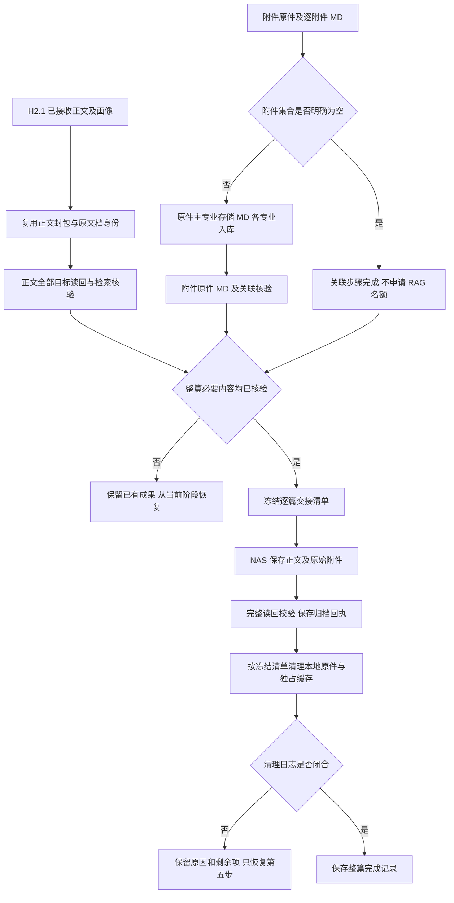

# 第四第五状态前端与 Prefect 3 接线设计

版本：stage45-20261029-v1；日期：2026-10-29。本设计覆盖第四状态及与第五状态的接口，上游以 H2.1 已接收回执为边界，沿用既有论文、正文、附件编号。

目标行为是逐篇完成“RAG 核验、NAS 核验、本地清理”。本文件中的前端扩展字段属于待实现的适配契约；现有模块和候选接线的位置在后文列出，不能把设计状态当作已部署功能。

## 端到端流程

正文和附件可以分别推进；整篇交给 NAS 时必须汇合。A 篇完成即进入 A 篇归档，不等待同批 B 篇正文上传结束。

## 上下游交付颗粒度

| 对象 | 交付内容 | 第四步处理 |
|---|---|---|
| 正文 | H2.1 接收身份、正文原件、按原模板生成的画像、已有封包及回执 | 核对来源、封印、任务身份、专业路由和切片；使用原文档身份继续入库 |
| 每个附件 | 原附件一份、`attachment.md` 一份、原件与 MD 哈希和接收回执 | 校验后保存；不另调模型补写说明 |
| 附件 MD | 编号、文件名、格式、大小、SHA256、类型、简单说明、读取依据和限制、包内目录 | MD 成为可检索说明，保持与原件唯一绑定 |
| 第四到第五步 | `paperflow-nas-handoff/1` JSON 清单 | 列出精确原件、对象指纹、RAG 证据、保留证据及清理候选 |

压缩附件保存完整 ZIP/RAR 原件。目录状态使用 `complete / partial / unavailable / not_archive / not_read`；没有读取成员内容就不能显示“已理解包内代码”。解压成员不自动成为独立附件，也不重复长期归档。

原件仅存最高关联专业的附件库。其他专业保存说明和原件引用，前端显示“原件存于某专业附件库”并提供下载入口。已有 CLI 和原生下载能力可复用；新的网页按钮及认证代理尚待接线。

## 页面设计

沿用现有任务列表、详情和操作组件。任务列表增加第四、第五步摘要，单篇详情展示原件及回执依据，附件详情展示说明 MD、目录和下载。

### 第四状态

| 展示项 | 含义与数据来源 |
|---|---|
| RAG 额度 | 同时显示目标额度、本机配置、远端全局额度和观察时间；不一致时显示原因 |
| 等待数量 | 候选 `rag-progress/1.counts.waiting`，包含等本机门控和全局额度 |
| 名额占用 | 候选 `counts.occupied`；全局 `active_slots` 单独标明服务与资源名，不能冒充相同统计范围 |
| 正在上传 | 实际请求观察得到的 `counts.uploading`；不能用 Running 数量替代 |
| 等待核验 | `counts.waiting_verification` |
| 正在核验 | `counts.verifying`，包括读回、启用与检索请求 |
| 已核验论文 | `counts.verified_papers`，按论文及版本去重；不是目标文档数 |
| 待核对 | `counts.unknown`，未知写入不得显示为可直接重新上传 |

名额占用与上传、等待核验、正在核验会重叠，不能把所有数字相加当总论文数。各专业目标进度另列“已核验目标数／必要目标数”。

`rag-progress/1` 当前是候选中的本地进程快照。适配层需校验 owner PID、进程创建时间或等价实例身份、最近更新时间及运行绑定；失效或缺失时显示“待核对”，数字用 null，不能自动补零。全局与单批统计必须标注范围，不能累加不同批次的同一论文身份。

### 第五状态

| 状态 | 前端文案 | 完成判断 |
|---|---|---|
| `not_ready` | 等待整篇 RAG 核验 | 展示缺正文、缺附件或证据不符的原因，不进入 NAS |
| `ready` | 等待 NAS | 第四步交接清单核验通过 |
| `copying` | 正在归档 NAS | 复制操作在途，不等于保存成功 |
| `verifying` | 正在核验 NAS | 读回文件大小、SHA256 和清单 |
| `verified` | NAS 已核验 | 完整 NAS 证据及回执齐全；本地清理另显示 |
| `cleanup_pending` | 等待本地清理 | 还未删除，或尚有待处理项 |
| `cleaning` | 正在清理本地 | 有持久删除意图，按文件推进 |
| `incomplete` | 清理未完成 | 仍有占用、未知或未闭合的项目 |
| `retained` | 部分文件保留 | 展示具体文件与原因，不显示全部已清理 |
| `complete` | 本篇交付完成 | NAS 核验通过、计划内清理完成、完成记录已保存 |

表中的 `copying / verifying / cleaning / cleanup_pending` 是前端显示状态，需要业务适配层从在途观察和持久记录组合，不能伪称现有回执已经直接提供这些字段。`Stage5Receiver` 实际返回的 `status` 主要为 `not_ready / ready / incomplete / complete`，其 `cleanup.status` 另有 `retained`。

本地个人目录可以继续保留。显示“原件已清理”只指清单内文件；最终 MD、请求回答、封包和回执仍在。旧完成记录可能只证明本地保留流程结束，前端应标为“历史归档完成，本地保留”，不能升级成新版清理完成。

## 前端扩展数据契约

保持现有任务响应的 `batch_id`、数值型 `revision`、`actions`、`command` 等字段。单篇的 H2.1 `paper_revision` 为字符串，与任务命令的数值 `revision` 区分；Prefect UUID、原生 task_id、paper_id、attachment_id 分别保存。

任务详情可增设 `stage45` 扩展，版本为 `paperflow-stage45-view/1`。批次摘要和逐篇数据可分别分页返回，具体 HTTP 路由由业务适配层实现；本次交付不声称新增接口已经可用。

| 字段 | 类型 | 规则 |
|---|---|---|
| `schema` | string | 固定 `paperflow-stage45-view/1` |
| `observed_at` | ISO8601 string 或 null | 适配层统一转 UTC；显示时按用户时区转换 |
| `availability` | `available / partial / unknown / stale` | 数据缺失或进程身份不符时不能显示正常实时数据 |
| `scope` | object | 明确服务、批次、数据根目录标识和运行实例；不向浏览器暴露凭据 |
| `prefect` | object | deployment_id、flow_run_id、task_run_id、调度状态；未创建则为 null |
| `rag.capacity` | object | target_limit、configured_limit、global_limit、global_active_slots、observed_at、aligned |
| `rag.counts` | object | waiting、occupied、uploading、waiting_verification、verifying、verified_papers、unknown；缺失为 null |
| `papers[]` | array | paper_id、paper_revision、第四／第五步状态及证据引用；总数另给分页信息 |
| `papers[].rag` | object | body、attachments、overall_state、目标覆盖、关联状态和失败原因 |
| `papers[].nas` | object | state、expected_files、verified_files、receipt_ref、reason_codes |
| `papers[].cleanup` | object | state、removed_files、reconciled_absent_files、pending_files、retained、unknown_files、completed_paths |
| `papers[].completion` | object | state、contract_version、record_ref；明确历史本地保留和新版清理契约 |
| `papers[].actions` | object | 后端给出 allowed、reason_codes 和恢复范围；未给出则禁用 |

计数单位为文件或论文时必须随字段固定。`reconciled_absent_files` 表示经原删除意图核对的缺失文件，不是本次又删了一遍；`removed_files` 也不等于物理空间回收量。参考样例见 `examples/前端状态样例.json`。

## 按钮与操作

沿用现有 `/api/v1/tasks`、`/api/v1/tasks/{batch_id}` 和 `start / pause / resume` 操作。当前这些是旧业务接口，仍需在服务端映射到 Prefect；不能只换一个前端 URL 就宣称接通。

继续使用 `request_id` 和 `expected_revision`。上一条命令 pending 时先读回；409 刷新任务版本，不自动换 request_id 重试。按钮只有在后端 `actions.<action>.allowed=true` 时可用。

| 动作 | 后端行为 |
|---|---|
| 开始 | 创建或认回原任务身份后提交 Prefect 运行；页面不能直接打开本机执行或清理开关 |
| 暂停 | 当前阶段保存已完成成果和未知请求，停止进入后续阶段；需实现业务收尾语义，不能把强制取消当暂停完成 |
| 继续 | 后端依据原身份和持久记录选择最早未完成阶段；RAG 失败进入入库恢复，NAS／清理失败进入第五步 |
| 回查入库 | 原文档、原切片和原件的只读回查；未知写入先查询，不能盲目创建替代对象 |
| 下载附件 | 后端按 paper_id、attachment_id 和已核验回执定位唯一原件并代理原生认证下载；核验大小和哈希，浏览器不持有服务密钥 |

“继续入库”“继续归档清理”“回查”“下载”可以作为详情页明确动作；其业务 API 扩展尚待实现，现有 CLI 能力不代表网页按钮已接通。下载失败不应触发重新识别或重新入库。

## Prefect 3 统一接线

现有部署为 `五步接入-手动运行`，ID `3c968368-58fc-40a0-9966-0ba2fde8c92c`，入口 `paperflow_prefect.flows.paperflow_batch`。现有第三步 H2.1 入口 `received_handoff` 明确停在第三步；必须保留它的独立边界。

| 接线位置 | 应接入内容 | 注意事项 |
|---|---|---|
| `flows.business_stage` | 空附件在门控前完成；正文和非空附件共用 `paperflow-connected-rag`；记录实际阶段 | 配置生成器、本机 gate、远端全局额度和 `verify_limits` 均为同一目标 20 |
| `Backend.publish_body` | 复用原封包及入库恢复能力 | 沿用 task/manifest/source/document/chunk 身份，超时先读回 |
| `Backend.publish_attachments` | 接收附件 MD 的新发布链路 | 主工程仍有旧 description 发布路径；合并时接入已验证的新模块，不同时走两套发布 |
| 单篇 RAG 汇合点 | `build_nas_handoff` 与 `validate_nas_handoff` | 全部必要正文、附件目标核验后才 ready；空附件是明确空集合 |
| `Backend.archive` 与第五步入口 | `Stage5Receiver.receive / archive / cleanup` | 保存不可变证据快照；NAS 核验后再清理 |
| 恢复入口及默认扫描 | `Stage5Receiver.resume` 和已有清理索引 | 原件已删除后不能重新扫描生成另一篇身份；只恢复第五步 |
| `finish` 及 flow 返回 | 原样传递真实业务完成结果 | 旧 `connected_paper.call` 对 finish 固定返回 complete，需要与第五步 incomplete/failures 结果一起合并 |
| 状态读接口 | 合并调度状态、实际请求观察和持久业务回执 | Prefect 状态只用于调度；前端完成判据以业务回执为准 |

第五步候选与 20 路候选都修改了 backend、flows、workflow 等共享位置，且分别基于不同时期源码。它们不能相互整目录覆盖；必须在最新主工程上按能力合并，再执行组合回归。

20 路验收分三层：本机配置和入口门控一致；远端全局额度与配置一致；多批同时运行时真实入口不超过总额度。现有本地临时 Prefect 验收已证明前两层组合及 25 个合成任务争用 20 个槽位，不代表生产 RAG 吞吐或已部署。

## NAS 和本地清理规则

NAS 长期保存正文原件及附件原件。压缩包按完整包保存。NAS 完整读回、清单及持久回执核验后，才考虑本地删除。

可清理中间产物必须有明确文件路径、大小、SHA256、对象指纹和已完成、可再生、单篇独占的生产者证明。共享、被引用、正在使用、对象改变或无法证明归属的项目保留并显示原因。所有 producer_record 无论后缀均受保护，清理与保留证据不得相交。

原件和清理范围以冻结清单为准，历史来源映射不能扩展到原总论文库或其他学生目录。清理前再次核对 NAS 证据、路径边界、对象、内容、占用和引用。逐文件先持久化 intent，再执行并记录结果；中断后按原意图核对，不能因为源文件缺失而重新调用模型。

完成状态必须同时满足：整篇 RAG 准入有效、NAS 已核验、计划内清理日志闭合、完成记录已保存。明确排除的保留材料继续显示；清理计划内有 retained／unknown／pending 项时不能显示全部完成。

## 前端和接线验收

| 场景 | 应看到的结果 |
|---|---|
| 25 项争用 20 个 RAG 名额 | 20 占用、5 等待；Running 数量与上传数分开 |
| 无附件论文 | 显示无附件，附件关联完成，附件不申请 RAG 槽；正文仍独立核验 |
| 附件完成而正文未完成 | 显示正文待完成；不归档、不清理 |
| A 篇完成而 B 篇仍上传 | A 进入 NAS，B 继续上传 |
| 上传超时、回执不明 | 显示待核对；继续使用原身份回查，不重复上传、不调模型 |
| NAS 尚未读回或回执不足 | 本地原件保持存在，显示具体缺项 |
| 删除后、日志结果落盘前中断 | 恢复核对原 intent 后继续剩余清理，不重跑上游 |
| 缓存共享、变化或占用 | 显示保留／等待原因；符合条件的其他文件按计划推进 |
| 状态快照过期或进程身份不符 | 显示待核对，计数不补零，禁止不确定操作 |
| 附件下载 | 返回同一原件，大小及 SHA256 一致；不把 API 密钥交给浏览器 |

组合接线验收还需核对部署入口、实际加载代码哈希和本机／远端额度；文档上传成功仅表示设计已同步。当前验收证据及源文件位置见《代码与验收交付清单》。
